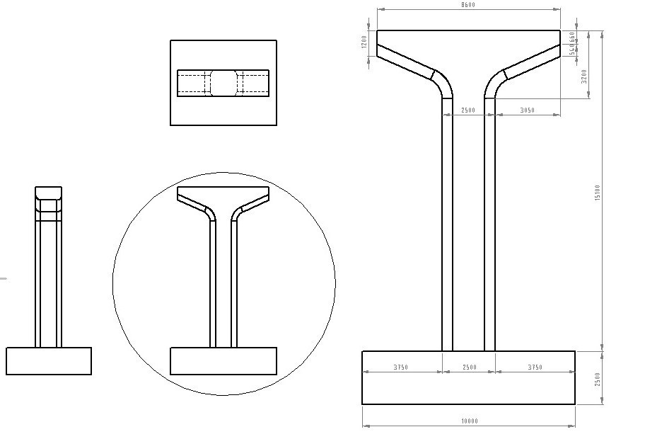
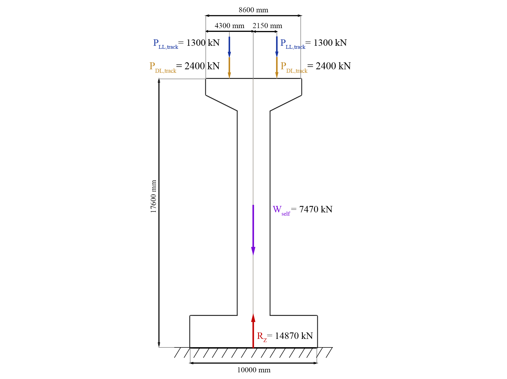
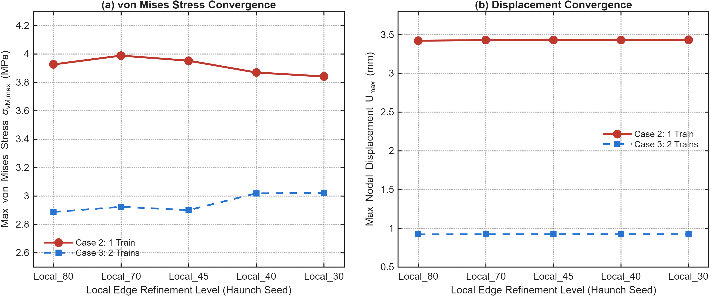
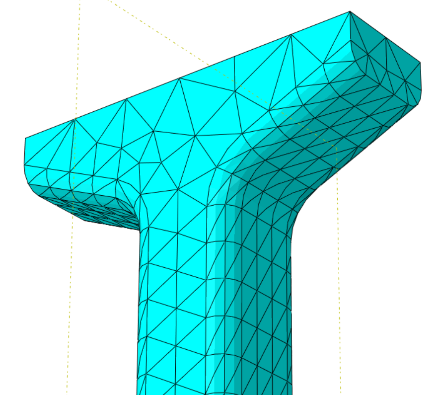
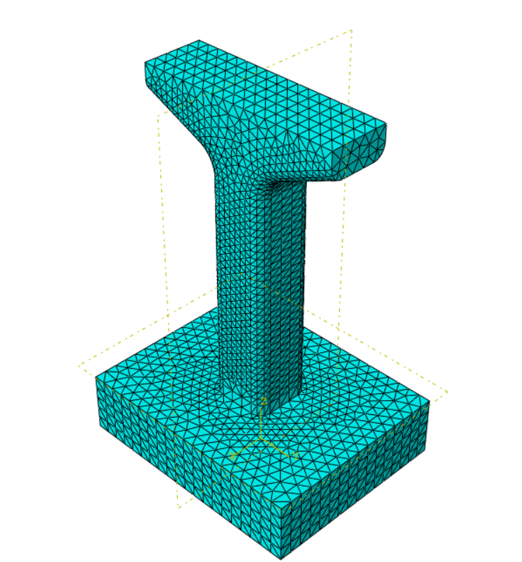
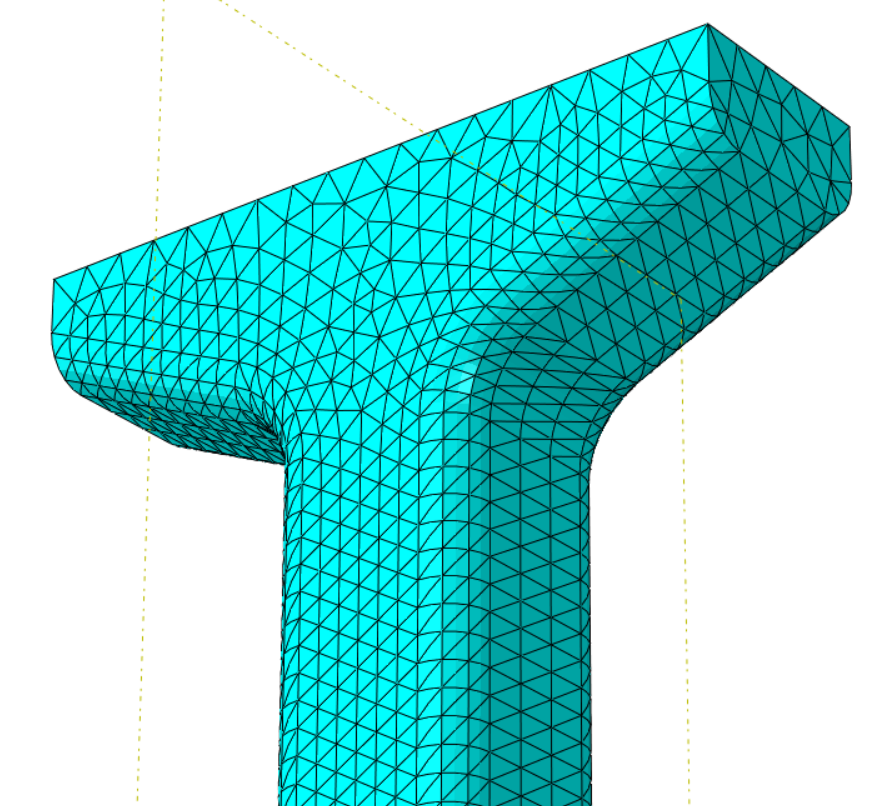
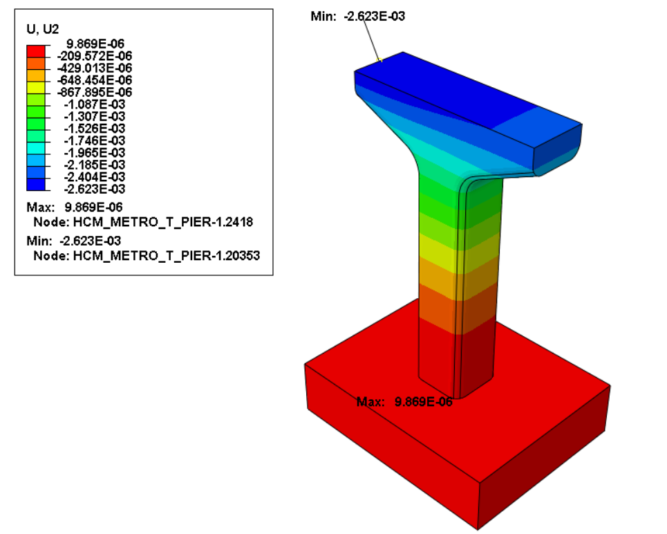
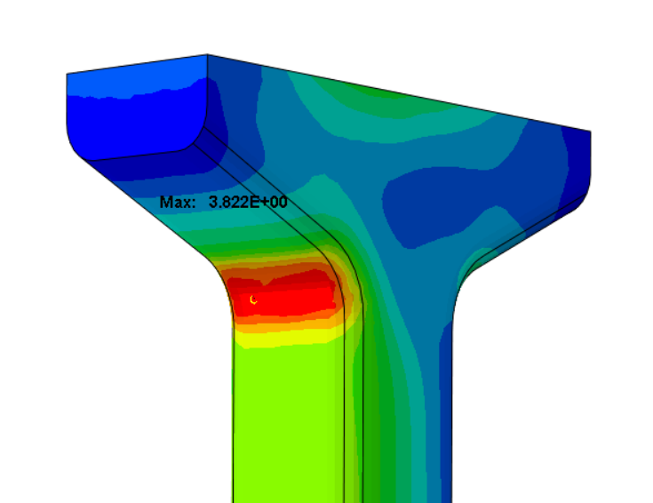
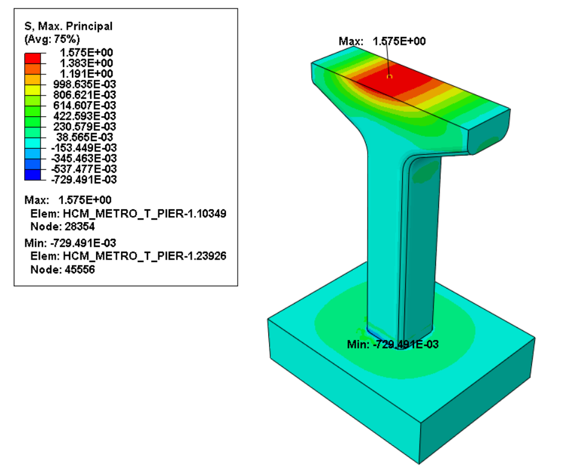

# hcmc metro viaduct t-pier 3d fea simulation (me2091)


finite element stress and serviceability deflection simulation of an elevated viaduct t-pier substructure for ho chi minh city metro line 1 (ben thanh - suoi tien) in abaqus/standard. contains complete abaqus simulation databases (.cae), parametric solver input decks (.inp), solved binary output databases (.odb), convergence and element diagnostics (.dat, .msg, .sta), matlab post-processing scripts, and high-resolution setup dialogs.

---

## outline

### simulation/ >>>>>abaqus setup<<<<<
* `hcm_metro_pier_analysis.cae`: full abaqus/cae database containing partitioned geometry, c40 concrete material definitions, encastre base constraint, step history (cases 1-3), global and local seed configurations, and all 5 parametric mesh jobs.
* `hcm_metro_tpier.cae`: abaqus/cae model database for the metro viaduct t-pier substructure.
* `Local_*.inp`: primary C3D10 quadratic tetrahedral solver input decks across all 5 seed refinement levels ($0.80\,\text{m} \to 0.30\,\text{m}$).

### data/ >>>>>output & diagnostics<<<<<
* `Local_*.odb`: solved binary abaqus output databases for primary C3D10 quadratic tetrahedral elements across all 5 refinement levels (`Local_80`, `Local_70`, `Local_45`, `Local_40`, `Local_30`).
* `Local_*.dat`, `.msg`, `.sta`: printed diagnostics, convergence tracking, and solver runtimes for C3D10 simulations.

### scripts/ >>>>>post-processing & visualization<<<<<
* `plot_figure6_mesh_convergence.m`: matlab script evaluating mesh convergence across all 5 refinement levels and exporting publication-ready dual-panel plots.

### images/ >>>>>high-res setup & analysis captures<<<<<
* viewport contour plots, haunch close-ups, partition diagrams, structural force diagrams, setup dialog captures, haunch path trajectory, and mesh convergence study.

### cloud storage >>>>>google drive archive<<<<<
* [google drive project folder](https://drive.google.com/drive/folders/1MDve9fqRGpeuwaL4kVvjr_tP8OT4T8uZ?usp=sharing): complete archive containing large binary output databases (`.odb`), full solver message diagnostics (`.dat`, `.msg`, `.sta`), SolidWorks CAD files (`.SLDPRT`, `.STEP`), and official MAUR project reference dossiers.

---

## substructure geometry & context



* **overall pier height:** $15.100\,\text{m}$ ($2.500\,\text{m}$ pile cap footing + $9.400\,\text{m}$ prismatic column stem + $3.200\,\text{m}$ crosshead).
* **crosshead breadth:** $8.600\,\text{m}$ across top bearing deck ($2.500\,\text{m}$ longitudinal track depth).
* **column cross-section:** $2.500\,\text{m} \times 2.500\,\text{m}$ square shaft ($R = 0.500\,\text{m}$ corner fillets).
* **cantilever haunch transitions:** double-curved concave circular fillets ($R = 2.000\,\text{m}$).

---

## abaqus model & simulation setup

### 1. coordinate system & boundary conditions


* **x-axis (track direction):** along the railway alignment ($[-1.250\,\text{m}, +1.250\,\text{m}]$).
* **y-axis (transverse):** along the crosshead cantilever arms ($[-4.300\,\text{m}, +4.300\,\text{m}]$).
* **z-axis (vertical):** opposed to gravity ($0.000\,\text{m}$ at pile cap bottom to $+15.100\,\text{m}$ at bearing seats).
* **foundation constraint:** fully fixed (encastre: $U_1 = U_2 = U_3 = UR_1 = UR_2 = UR_3 = 0$) across the bottom surface of the footing ($10.0\,\text{m} \times 8.0\,\text{m} = 80.0\,\text{m}^2$).

### 2. structural loading diagram & force balance


* **concrete self-weight:** design unit weight $\gamma_c = 24.5\,\text{kN/m}^3 \times 304.9\,\text{m}^3 \approx 7,470\,\text{kN}$ ($g = -9,810\,\text{mm/s}^2$ downward along $z$-axis).
* **dead load pressure (twin spans):** $q_{\text{dead}} = 0.223\,\text{MPa}$ ($P_{\text{dead}} = 4,800\,\text{kN}$ across bearing deck areas, $L_{\text{trib}} = 30.0\,\text{m}$).
* **train live load pressure:** $q_{\text{train}} = 0.121\,\text{MPa}$ ($P_{\text{train}} = 1,300\,\text{kN}$ per track).
  * **case 1 (no train):** dead load only ($q_1 = q_2 = 0.223\,\text{MPa}$, $P = 4,800\,\text{kN}$, static equilibrium $R_z \approx 12,270\,\text{kN}$, FEA reaction $R_z = 12,122\,\text{kN}$).
  * **case 2 (1 train on track 1):** asymmetric live loading ($q_1 = 0.344\,\text{MPa}, q_2 = 0.223\,\text{MPa}$, $P = 6,100\,\text{kN}$, static equilibrium $R_z \approx 13,570\,\text{kN}$, FEA reaction $R_z = 13,423\,\text{kN}$), inducing overturning moment $M_0 \approx 2,795\,\text{kN}\cdot\text{m}$.
  * **case 3 (2 trains):** symmetric live loading ($q_1 = q_2 = 0.344\,\text{MPa}$, $P = 7,400\,\text{kN}$, static equilibrium $R_z \approx 14,870\,\text{kN}$, FEA reaction $R_z = 14,724\,\text{kN}$), producing maximum axial compression.

### 3. material properties


* **concrete grade:** high-performance concrete (hpc) grade c40 (tcvn 11823:2017).
* **young's modulus:** $E = 32,500\,\text{MPa}$ ($3.25 \times 10^4\,\text{N/mm}^2$).
* **poisson's ratio:** $\nu = 0.20$.
* **mass density:** $\rho = 2,450\,\text{kg/m}^3 \rightarrow \rho_{\text{FEA}} = 2.45 \times 10^{-9}\,\text{tonne/mm}^3$.

---

## hybrid mesh refinement & convergence study

to achieve high-fidelity stress resolution around the haunch re-entrant corners while tracking convergence across progressive mesh densities, localized edge seeding was systematically refined from $h_{\text{local}} = 0.80\,\text{m}$ down to $0.30\,\text{m}$ across 5 discrete solver jobs:
* **global seed size:** $h_{\text{global}} = 0.50\,\text{m}$ assigned across the solid domain.
* **local haunch partition seed:** $h_{\text{local}}$ refined from $0.80\,\text{m}$ to $0.30\,\text{m}$.

| Mesh Level | Job Name | Local Seed $h_{\text{local}}$ (m) | Elements (C3D10) | Nodes | Total DOFs | CPU Time (s) | Case 2 Mises $\sigma_{\text{vM}}$ (MPa) | Case 3 Mises $\sigma_{\text{vM}}$ (MPa) | Case 2 Tip Disp $\vert\mathbf{U}\vert$ (mm) | Case 3 Settlement $\vert\mathbf{U}\vert$ (mm) |
| :---: | :---: | :---: | :---: | :---: | :---: | :---: | :---: | :---: | :---: | :---: |
| 1 | `Local_80` | 0.80 | 3,193 | 5,386 | 16,158 | 2.8 | 3.927 | 2.888 | 3.422 | 0.922 |
| 2 | `Local_70` | 0.70 | 16,854 | 25,836 | 77,508 | 16.0 | 3.989 | 2.924 | 3.430 | 0.923 |
| 3 | `Local_45` | 0.45 | 20,739 | 31,596 | 94,788 | 12.0 | 3.953 | 2.901 | 3.430 | 0.924 |
| 4 | `Local_40` | 0.40 | 21,582 | 32,852 | 98,556 | 13.0 | 3.870 | 3.019 | 3.430 | 0.924 |
| 5 (Optimal) | `Local_30` | 0.30 | 32,111 | 48,360 | 145,080 | 20.0 | 3.842 | 3.021 | 3.433 | 0.924 |



### mesh comparison: coarse vs fine haunch discretization
| Mesh: Local_80 Overview | Mesh: Local_80 Haunch Detail |
| :---: | :---: |
|  |  |
| **Mesh: Local_30 Overview (Optimal)** | **Mesh: Local_30 Haunch Detail** |
|  |  |

---

## visual results (optimal local_30)

### 1. 3d nodal displacement field contours ($U_2$ transverse & $U_3$ vertical)

| Case 2: Transverse Displacement $U_2$ (1 Train) | Case 2: Vertical Displacement $U_3$ (1 Train) |
| :---: | :---: |
|  |  |

* **case 2 cantilever flexure:** eccentric train traffic induces transverse sway ($U_2 = -2.623\,\text{mm}$) and crosshead tip deflection ($U_3 = -2.214\,\text{mm}$), producing a resultant 3D tip deflection $\vert\mathbf{U}\vert = 3.433\,\text{mm}$ below the allowable serviceability limit ($\Delta_{\text{allow}} = \frac{L}{800} = 3.813\,\text{mm}$, reserve margin $10.0\%$).
* **case 3 axial settlement:** balanced dual-track loading eliminates net overturning moment, resulting in uniform elastic downward settlement of $U_3 = -0.924\,\text{mm}$ ($\vert\mathbf{U}\vert = 0.924\,\text{mm}$).

### 2. von mises stress contours & haunch stress concentrations

| Case 2: One Train (Overall View) | Case 2: Haunch Root Close-up |
| :---: | :---: |
|  |  |
| **Case 3: Two Trains (Overall View)** | **Case 3: Haunch Root Close-up** |
|  |  |

* **case 2 peak stress:** localized constitutive von mises stress reaches $\sigma_{\text{vM}} = 3.842\,\text{MPa}$ at element integration points along the haunch re-entrant corner fillet ($R = 2.000\,\text{m}$).
* **case 3 peak stress:** symmetric haunch constitutive stress reaches $\sigma_{\text{vM}} = 3.021\,\text{MPa}$.

### 3. principal stress fields ($\sigma_1$ tension & $\sigma_3$ compression)

| Maximum Principal Stress ($\sigma_1$, Tension) | Minimum Principal Stress ($\sigma_3$, Compression) |
| :---: | :---: |
|  |  |

* **$\sigma_1$ (tensile cracking check):** peak tensile principal stress $S_{1,\text{max}} = 1.671\,\text{MPa}$ develops along the crosshead upper fibers, providing a safety factor against concrete rupture:
  $$ \text{SF}_{\text{crack}} = \frac{f_r}{S_{1,\text{max}}} = \frac{3.984\,\text{MPa}}{1.671\,\text{MPa}} = 2.38 > 1.0 $$
* **$\sigma_3$ (compressive crushing check):** peak compressive principal stress $\vert S_{3,\text{min}}\vert = 4.446\,\text{MPa}$ concentrates at the haunch re-entrant corner under Case 2 (1 Train), yielding a crushing safety factor:
  $$ \text{SF}_{\text{crush}} = \frac{0.60 f'_c}{\vert S_{3,\text{min}}\vert} = \frac{24.00\,\text{MPa}}{4.446\,\text{MPa}} = 5.40 \gg 1.0 $$

### 4. stress distribution along haunch path


---

## usage & reproduction

### option a: run solver directly via abaqus cli
```bash
abaqus job=Local_30 input=simulation/Local_30.inp interactive
```

### option b: open complete model in abaqus/cae
1. launch abaqus/cae.
2. `File` $\rightarrow$ `Open Database` $\rightarrow$ select `simulation/hcm_metro_pier_analysis.cae`.
3. under the **Job** module, submit `Local_30` or any of the parametric jobs (`Local_80`, `Local_70`, `Local_45`, `Local_40`).

### option c: inspect precomputed output database
```bash
abaqus viewer odb=data/Local_30.odb
```

### option d: reproduce mesh convergence plot
```matlab
run('scripts/plot_figure6_mesh_convergence.m')
```

---

## references

* **metro line 1 dossier:** management authority for urban railways (maur), *design documentation for ho chi minh city urban railway construction project: substructure and superstructure specifications (cầu giản đơn dầm chữ u btdul)*, hcmc, 2020.
* **bridge design code:** ministry of science and technology, *tcvn 11823:2017: highway bridge design specifications (tiêu chuẩn thiết kế cầu đường bộ)*, ministry of transport, hanoi, 2017.
* **fea methodology:** chandrupatla & belegundu, *introduction to finite elements in engineering*, 4th ed., pearson, 2012.
* **abaqus theory:** dassault syst\`emes, *abaqus/cae user's guide* and *abaqus theory guide*, ver. 2024.
