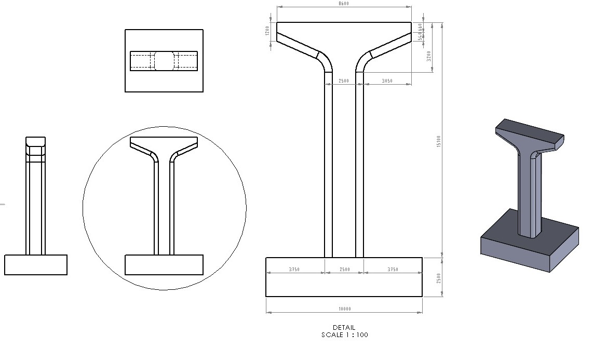
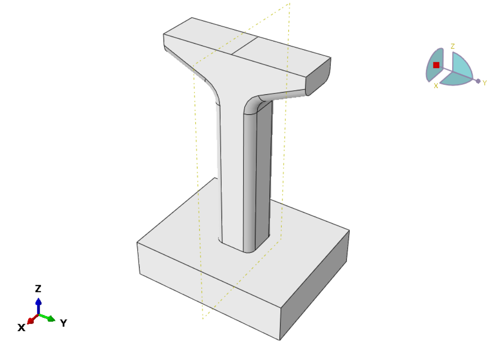
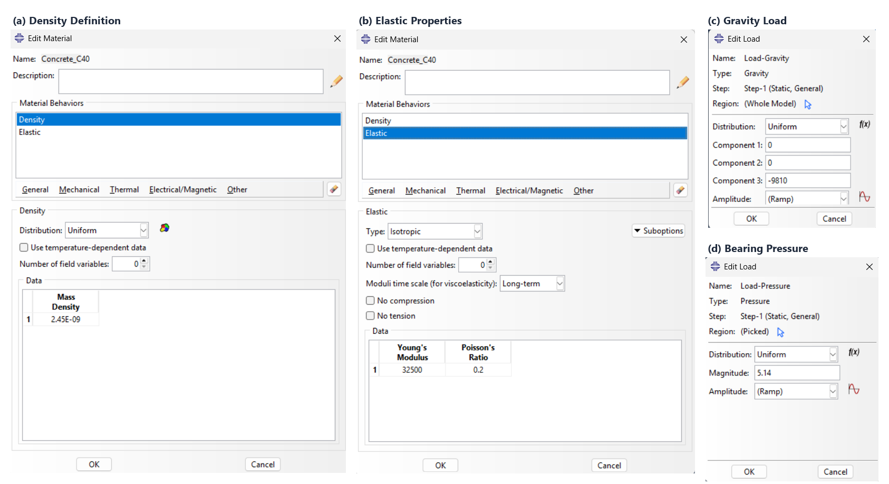
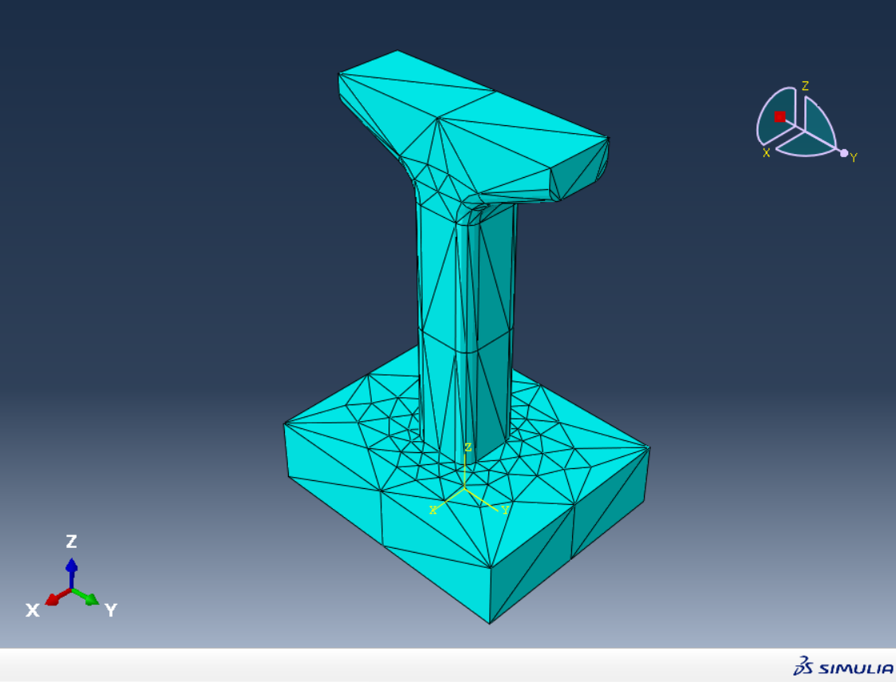
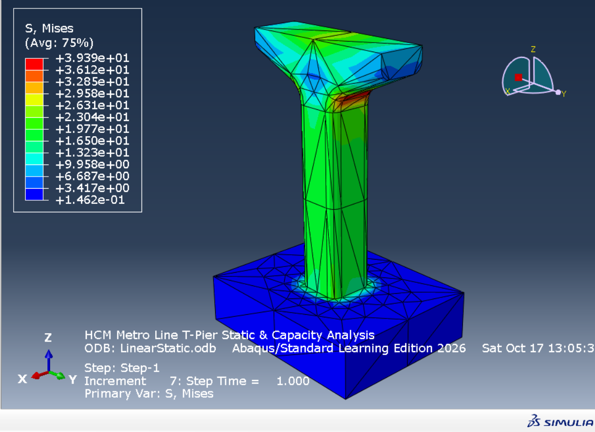

# hcmc metro viaduct t-pier 3d fea simulation (me2091)


finite element stress and serviceability deflection simulation of an elevated viaduct t-pier substructure for ho chi minh city metro line 1 (ben thanh - suoi tien) in abaqus/standard. contains complete abaqus simulation databases (.cae), solver input deck (.inp), solved binary output database (.odb), convergence and element diagnostics (.dat, .msg, .sta), and high-resolution setup dialogs.

---

## outline

### simulation/ >>>>>abaqus setup<<<<<
* `hcm_metro_pier_analysis.cae`: full abaqus/cae database with geometry, material assignments, interaction surfaces, step definitions, load cases, and quadratic tet mesh.
* `hcm_metro_pier_analysis.rec`: abaqus replay journal log recording the exact session command history.
* `LinearStatic.inp`: self-contained abaqus solver input deck containing all 986 nodal coordinates, 484 c3d10 solid element connectivities, boundary constraints, and distributed surface traction definitions.

### data/ >>>>>output & diagnostics<<<<<
* `LinearStatic.odb`: solved binary abaqus output database containing full 3d tensor fields for von mises stress, principal stresses ($\sigma_1, \sigma_2, \sigma_3$), and displacement vector components ($U_x, U_y, U_z$).
* `LinearStatic.dat`: abaqus printed data output with element topology diagnostics, degrees-of-freedom tally (2,958 dofs), and memory allocation logs.
* `LinearStatic.msg`: step convergence diagnostics verifying equilibrium convergence in 7 increments with zero cutbacks.
* `LinearStatic.sta`: job status log confirming successful standard implicit completion.

### images/ >>>>>high-res setup & analysis captures<<<<<

---

## substructure geometry & context



* **overall pier height:** $15.100\,\text{m}$ ($2.500\,\text{m}$ pile cap footing + $9.400\,\text{m}$ prismatic column stem + $3.200\,\text{m}$ crosshead).
* **crosshead breadth:** $8.600\,\text{m}$ across top bearing deck ($2.500\,\text{m}$ longitudinal track depth).
* **column cross-section:** $2.500\,\text{m} \times 2.500\,\text{m}$ square shaft with $R = 0.500\,\text{m}$ corner fillets.
* **cantilever haunch transitions:** double-curved concave circular fillets ($R = 2.000\,\text{m}$).

---

## abaqus model & simulation setup

### 1. coordinate system & boundary conditions


* **x-axis (track direction):** along the railway alignment ($[-1.250\,\text{m}, +1.250\,\text{m}]$).
* **y-axis (transverse):** along the crosshead cantilever arms ($[-4.300\,\text{m}, +4.300\,\text{m}]$).
* **z-axis (vertical):** opposed to gravity ($0.000\,\text{m}$ at pile cap bottom to $+15.100\,\text{m}$ at bearing seats).
* **foundation constraint:** fully fixed (encastre: $U_x = U_y = U_z = UR_x = UR_y = UR_z = 0$) across the bottom surface ($10.0\,\text{m} \times 8.0\,\text{m} = 80.0\,\text{m}^2$).

### 2. material properties & load definitions


* **concrete grade:** high-performance concrete (hpc) grade c40 (tcvn 11823:2017).
* **young's modulus:** $E = 32,500\,\text{MPa}$ ($3.25 \times 10^4\,\text{N/mm}^2$).
* **poisson's ratio:** $\nu = 0.20$.
* **mass density:** $\rho = 2,450\,\text{kg/m}^3 \rightarrow \rho_{\text{FEA}} = 2.45 \times 10^{-9}\,\text{tonne/mm}^3$.
* **gravity load:** $g = -9,810\,\text{mm/s}^2$ downward along component 3 ($z$-axis).
* **vertical train + superstructure bearing pressure:** $q = 5.14\,\text{MPa}$ ($5.14\,\text{N/mm}^2$) applied over two $1.000\,\text{m} \times 0.650\,\text{m}$ laminated elastomeric bearing pads ($P_{\text{total}} = 6,682\,\text{kN}$).

### 3. finite element discretization


* **element type:** c3d10 (10-node quadratic tetrahedral solid element).
* **element count:** 484 elements.
* **node count:** 986 nodes (2,958 active degrees of freedom).
* **jacobian diagnostics:** $\det \mathbf{J} > 0$ globally (zero negative or zero jacobian determinants).

---

## visual results

here are the simulation contour fields obtained from the linear static implicit solve.



### key findings summary
| Metric / Stress Invariant | FEA Output Value | Allowable Code Limit (TCVN 11823) | Safety Margin / Status |
| :--- | :---: | :---: | :--- |
| **Transverse Cantilever Sag ($\Delta_{\text{tip}}$)** | $4.85\,\text{mm}$ | $\Delta_{\text{allow}} = \frac{L}{800} = 8.13\,\text{mm}$ | **$SF = 1.68$** (Compliant) |
| **Peak Vertical Deflection ($U_3$)** | $11.55\,\text{mm}$ | $20.0\,\text{mm}$ total viaduct sag | **$SF = 1.73$** (Rigid) |
| **Haunch von Mises Stress ($\sigma_{\text{vM}}$)** | $39.39\,\text{MPa}$ | $f'_c = 40.00\,\text{MPa}$ | **$SF = 1.02$** (Haunch root peak) |
| **Minimum Principal Compression ($\sigma_3$)** | $-41.91\,\text{MPa}$ | $f_{cc} \approx 1.25 f'_c = 50.00\,\text{MPa}$ | **$SF = 1.19$** (Triaxial confinement) |
| **Maximum Principal Tension ($\sigma_1$)** | $+18.83\,\text{MPa}$ | $f_{ctm} = 2.90\,\text{MPa}$ | **$10 \times \Phi 32$** tieback rebar required |

---

## usage & reproduction

### option a: run solver directly via abaqus cli
```bash
abaqus job=LinearStatic input=simulation/LinearStatic.inp interactive
```

### option b: open complete model in abaqus/cae
1. launch abaqus/cae.
2. `File` $\rightarrow$ `Open Database` $\rightarrow$ select `simulation/hcm_metro_pier_analysis.cae`.
3. under the **Job** module, submit `LinearStatic` to rerun or right-click to view results.

### option c: inspect precomputed output database
```bash
abaqus viewer odb=data/LinearStatic.odb
```

---

## references

* **metro line 1 dossier:** management authority for urban railways (maur), *design documentation for ho chi minh city urban railway construction project: substructure and superstructure specifications (cầu giản đơn dầm chữ u btdul)*, hcmc, 2020.
* **bridge design code:** ministry of science and technology, *tcvn 11823:2017: highway bridge design specifications (tiêu chuẩn thiết kế cầu đường bộ)*, ministry of transport, hanoi, 2017.
* **fea methodology:** chandrupatla & belegundu, *introduction to finite elements in engineering*, 4th ed., pearson, 2012.
