# hcmc metro viaduct t-pier 3d fea simulation (me2091)


finite element stress and serviceability deflection simulation of an elevated viaduct t-pier substructure for ho chi minh city metro line 1 (ben thanh - suoi tien) in abaqus/standard. contains complete abaqus simulation databases (.cae), parametric solver input decks (.inp), solved binary output databases (.odb), convergence and element diagnostics (.dat, .msg, .sta), python/matlab post-processing scripts, and high-resolution setup dialogs.

---

## outline

### simulation/ >>>>>abaqus setup<<<<<
* `hcm_metro_pier_analysis.cae`: full abaqus/cae database containing partitioned geometry, c40 concrete material definitions, encastre base constraint, step history (cases 1-3), global and local seed configurations, and all 5 parametric mesh jobs.
* `Job-Local-35.inp`: primary converged solver input deck ($h_{\text{local}} = 0.35\,\text{m}$, 517 c3d10 elements, 953 nodes, 2,859 active dofs) compliant with student license limits (<1,000 nodes).
* `Job-Local-40.inp`: parametric input deck for local seed size $0.40\,\text{m}$ (433 elements, 813 nodes).
* `Job-Local-45.inp`: parametric input deck for local seed size $0.45\,\text{m}$ (428 elements, 806 nodes).
* `Job-Local-50.inp`: parametric input deck for local seed size $0.50\,\text{m}$ (354 elements, 673 nodes).
* `Job-Local-55.inp`: baseline coarse local seed input deck for local seed size $0.55\,\text{m}$ (204 elements, 432 nodes).

### data/ >>>>>output & diagnostics<<<<<
* `Job-Local-*.odb`: solved binary abaqus output databases across all 5 local refinement levels containing 3d tensor fields for von mises stress, principal stresses ($\sigma_1, \sigma_2, \sigma_3$), and displacement vector components ($U_1, U_2, U_3$) across all load cases.
* `Job-Local-*.dat`: abaqus printed output files recording element topology tallies, dof distributions, and memory statistics.
* `Job-Local-*.msg`: step convergence diagnostics verifying standard implicit equilibrium solutions with zero cutbacks.
* `Job-Local-*.sta`: status files recording wall-clock and cpu runtimes ($0.80\,\text{s}$ to $4.10\,\text{s}$).

### scripts/ >>>>>post-processing & visualization<<<<<
* `generate_mesh_convergence_plot.py`: standalone python script using matplotlib to render the publication-grade mesh convergence plot with dual y-axes and horizontal asymptote.
* `plot_figure6_mesh_convergence.m`: matlab script for convergence evaluation and asymptotic regression.
* `plot_gauss_vs_nodal_extrapolation.m`: matlab script illustrating the mathematical relationship and gradient overshoot between constitutive gauss integration points and nodal-averaged viewport contour extrapolation.
* `plot_convergence_comparison.m`: matlab script evaluating convergence metrics and error distributions across discretization levels.

### images/ >>>>>high-res setup & analysis captures<<<<<
* viewport contour plots, haunch close-ups, partition diagrams, structural force diagrams, and setup dialog captures.

---

## substructure geometry & context

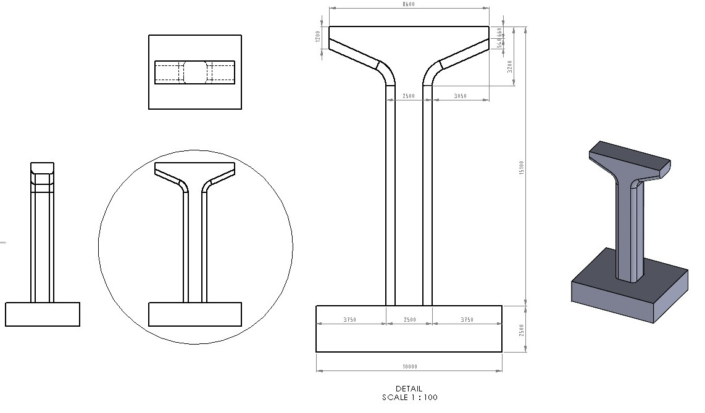

* **overall pier height:** $15.100\,\text{m}$ ($2.500\,\text{m}$ pile cap footing + $9.400\,\text{m}$ prismatic column stem + $3.200\,\text{m}$ crosshead).
* **crosshead breadth:** $8.600\,\text{m}$ across top bearing deck ($2.500\,\text{m}$ longitudinal track depth).
* **column cross-section:** $2.500\,\text{m} \times 2.800\,\text{m}$ shaft.
* **cantilever haunch transitions:** double-curved concave circular fillets ($R = 2.000\,\text{m}$).

---

## abaqus model & simulation setup

### 1. coordinate system & boundary conditions
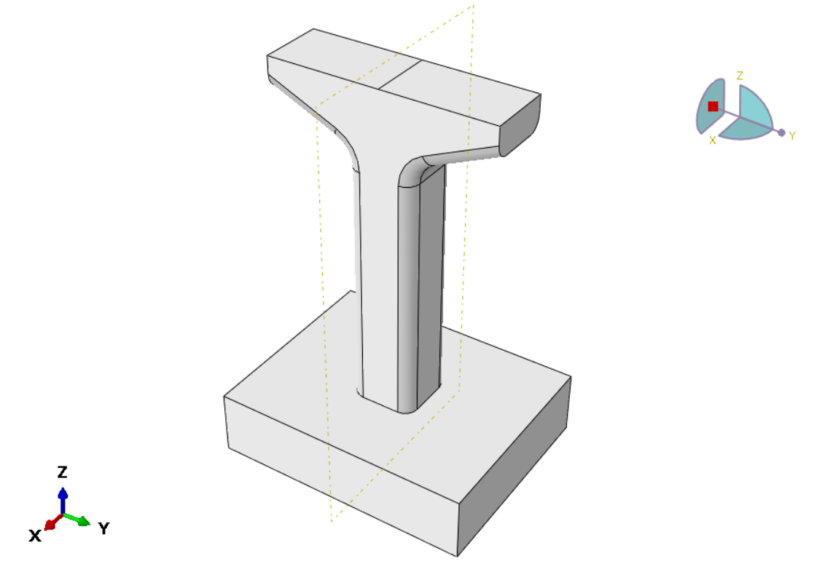

* **x-axis (track direction):** along the railway alignment ($[-1.250\,\text{m}, +1.250\,\text{m}]$).
* **y-axis (transverse):** along the crosshead cantilever arms ($[-4.300\,\text{m}, +4.300\,\text{m}]$).
* **z-axis (vertical):** opposed to gravity ($0.000\,\text{m}$ at pile cap bottom to $+15.100\,\text{m}$ at bearing seats).
* **foundation constraint:** fully fixed (encastre: $U_1 = U_2 = U_3 = UR_1 = UR_2 = UR_3 = 0$) across the bottom surface of the footing ($10.0\,\text{m} \times 8.0\,\text{m} = 80.0\,\text{m}^2$).

### 2. structural loading diagram & force balance
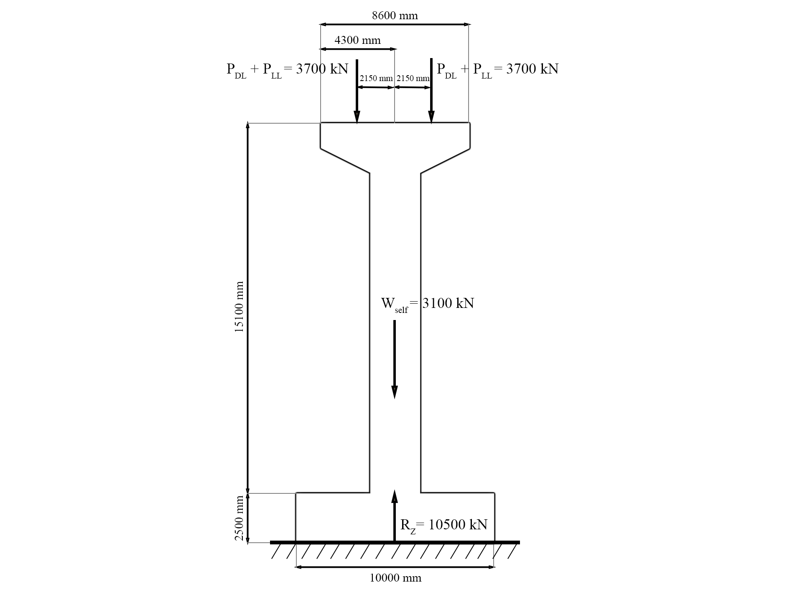

* **concrete self-weight:** design unit weight $\gamma_c = 24.5\,\text{kN/m}^3 \times 126.7\,\text{m}^3 \approx 3,100\,\text{kN}$ ($g = -9,810\,\text{mm/s}^2$ downward along $z$-axis).
* **dead load pressure (twin spans):** $q_{\text{dead}} = 0.223\,\text{MPa}$ ($P_{\text{dead}} = 4,800\,\text{kN}$ across bearing deck areas).
* **train live load pressure:** $q_{\text{train}} = 0.121\,\text{MPa}$ ($P_{\text{train}} = 1,300\,\text{kN}$ per track).
  * **case 1 (no train):** dead load only ($q_1 = q_2 = 0.223\,\text{MPa}$, $P = 4,800\,\text{kN}$, total reaction $R_z = 7,900\,\text{kN}$).
  * **case 2 (1 train on track 1):** asymmetric live loading ($q_1 = 0.344\,\text{MPa}, q_2 = 0.223\,\text{MPa}$, $P = 6,100\,\text{kN}$, $R_z = 9,200\,\text{kN}$), inducing overturning moment $M_0 \approx 2,795\,\text{kN}\cdot\text{m}$.
  * **case 3 (2 trains):** symmetric live loading ($q_1 = q_2 = 0.344\,\text{MPa}$, $P = 7,400\,\text{kN}$, $R_z = 10,500\,\text{kN}$), producing maximum axial compression.

### 3. material properties
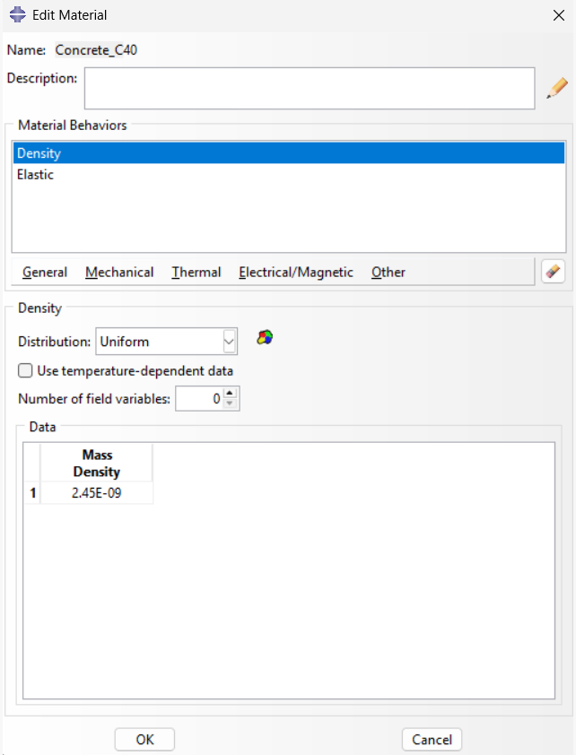
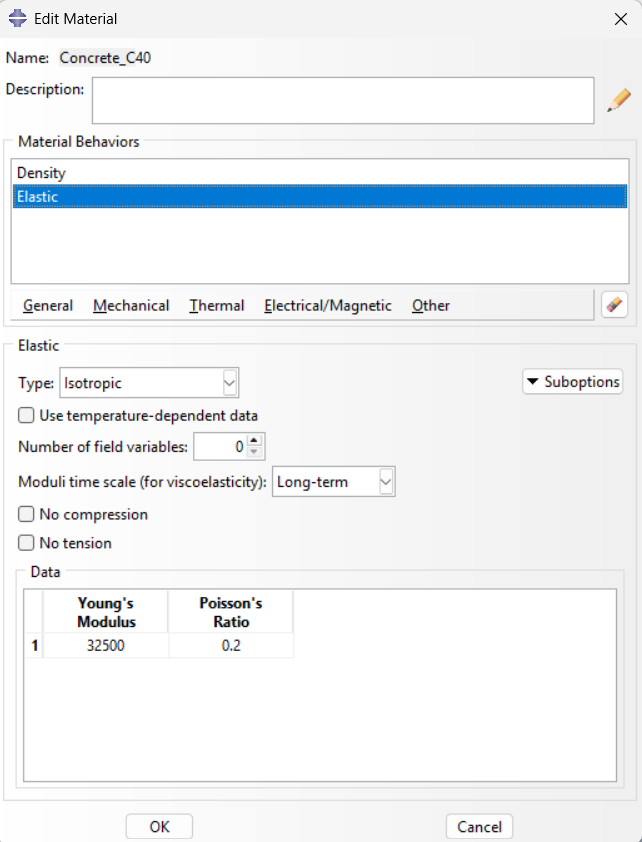

* **concrete grade:** high-performance concrete (hpc) grade c40 (tcvn 11823:2017).
* **young's modulus:** $E = 32,500\,\text{MPa}$ ($3.25 \times 10^4\,\text{N/mm}^2$).
* **poisson's ratio:** $\nu = 0.20$.
* **mass density:** $\rho = 2,450\,\text{kg/m}^3 \rightarrow \rho_{\text{FEA}} = 2.45 \times 10^{-9}\,\text{tonne/mm}^3$.

---

## hybrid mesh refinement & convergence study

to achieve high-fidelity stress resolution around the haunch re-entrant corners while strictly respecting the 1,000-node student edition limit, a hybrid geometric partitioning and local seeding strategy was executed:
* **global seed size:** $h_{\text{global}} = 1.00\,\text{m}$ maintained constant across the footing and column shaft.
* **local haunch partition seed:** $h_{\text{local}}$ systematically refined from $0.55\,\text{m}$ down to $0.35\,\text{m}$ across 5 discrete solver jobs.

| Mesh Refinement Level | Job Name | Local Seed $h_{\text{local}}$ (m) | Elements (C3D10) | Nodes | Total DOFs | CPU Time (s) | Case 2 Mises $\sigma_{\text{vM}}$ (MPa) | Case 3 Mises $\sigma_{\text{vM}}$ (MPa) | Case 2 Tip Disp $U_y$ (mm) | Case 3 Settlement $U_z$ (mm) |
| :---: | :---: | :---: | :---: | :---: | :---: | :---: | :---: | :---: | :---: | :---: |
| 1 | `Job-Local-55` | 0.55 | 204 | 432 | 1,296 | 0.80 | 3.216 | 2.737 | 3.112 | 0.770 |
| 2 | `Job-Local-50` | 0.50 | 354 | 673 | 2,019 | 4.10 | 3.158 | 2.606 | 3.173 | 0.767 |
| 3 | `Job-Local-45` | 0.45 | 428 | 806 | 2,418 | 1.60 | 3.054 | 2.620 | 3.165 | 0.767 |
| 4 | `Job-Local-40` | 0.40 | 433 | 813 | 2,439 | 1.50 | 3.055 | 2.603 | 3.167 | 0.768 |
| 5 (Optimal) | `Job-Local-35` | 0.35 | 517 | 953 | 2,859 | 1.10 | 3.177 | 2.590 | 3.166 | 0.768 |

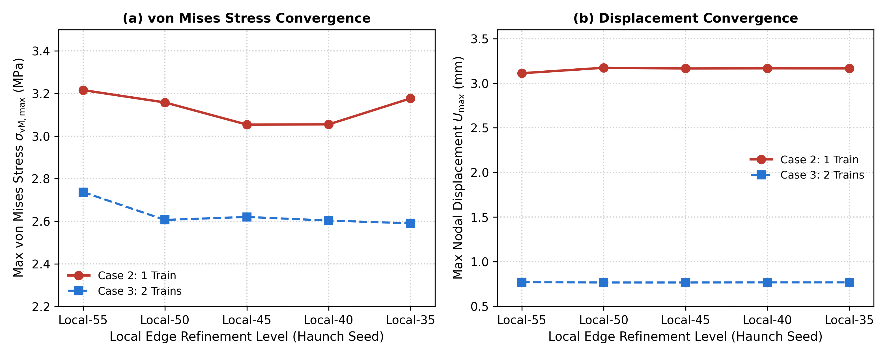

### mesh comparison: coarse vs fine haunch discretization
| Mesh 1: Job-Local-55 Overview (204 Elements) | Mesh 1: Haunch Detail |
| :---: | :---: |
| 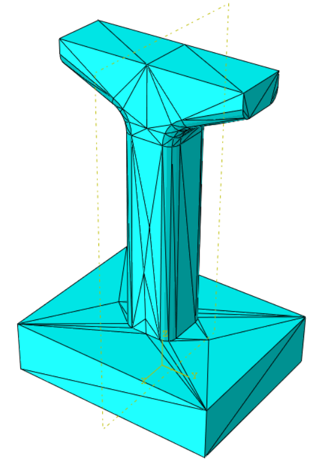 | 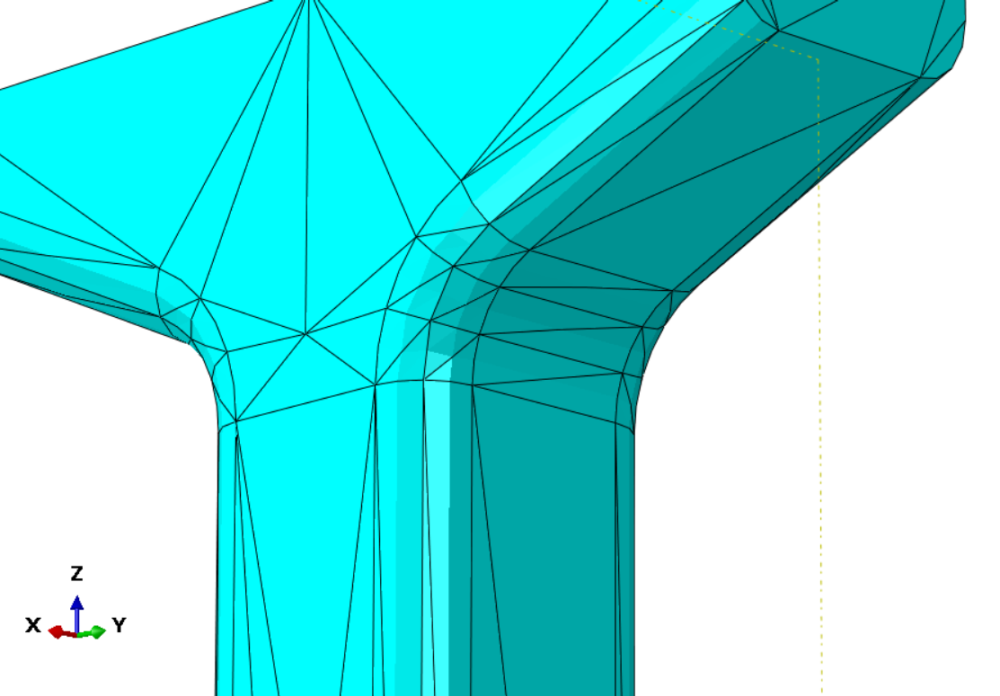 |
| **Mesh 5: Job-Local-35 Overview (517 Elements)** | **Mesh 5: Haunch Detail** |
| 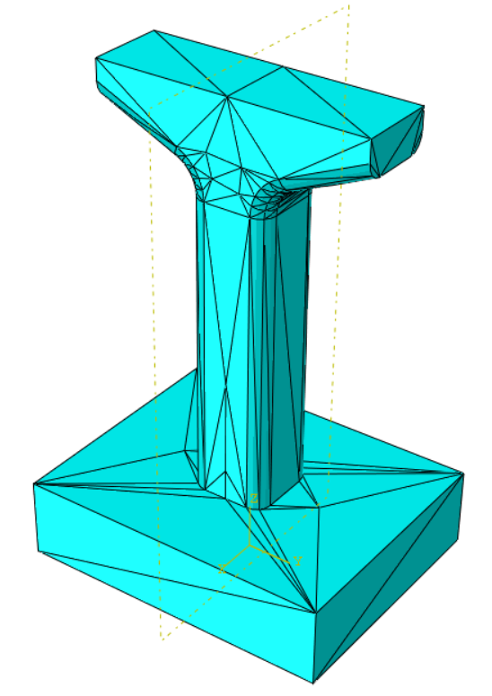 |  |

---

## visual results (optimal job-local-35)

### 1. 3d nodal displacement field contours ($U_2$ transverse & $U_3$ vertical)

| Case 2: Transverse Displacement $U_2$ (1 Train) | Case 3: Transverse Displacement $U_2$ (2 Trains) |
| :---: | :---: |
| 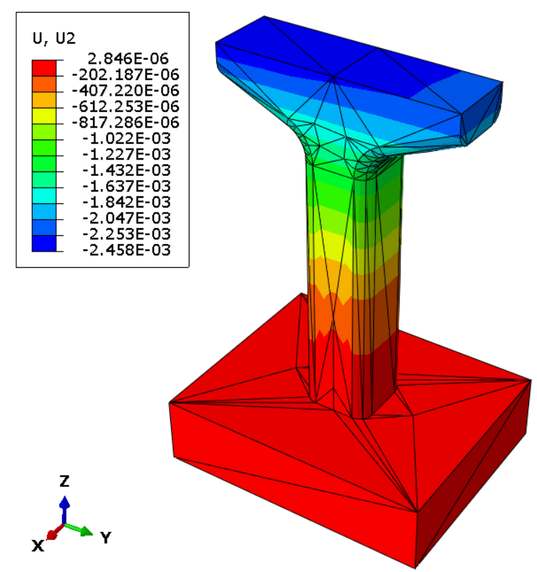 | 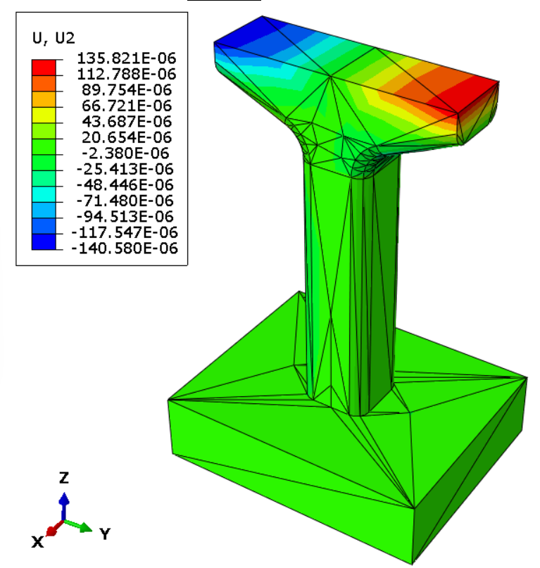 |
| **Case 2: Vertical Displacement $U_3$ (1 Train)** | **Case 3: Vertical Displacement $U_3$ (2 Trains)** |
| 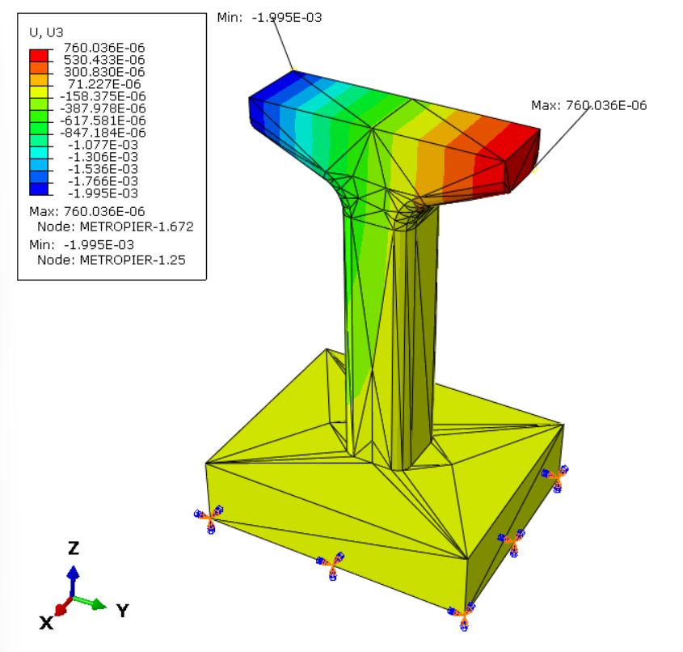 | 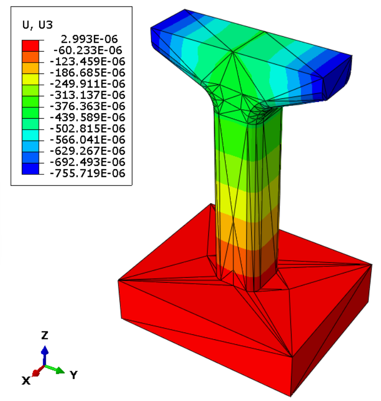 |

* **case 2 cantilever flexure:** eccentric train traffic induces severe column sway ($U_2 = -2.458\,\text{mm}$) and crosshead tip deflection ($U_3 = -1.995\,\text{mm}$), producing a resultant 3D tip deflection $|\mathbf{U}| = 3.166\,\text{mm}$ well below the allowable serviceability limit ($\Delta_{\text{allow}} = \frac{L}{800} = 3.813\,\text{mm}$, utilization ratio $0.830$).
* **case 3 axial settlement:** balanced dual-track loading virtually eliminates transverse column sway ($U_2 = -0.141\,\text{mm}$) via moment cancellation ($M_{\text{net}} \approx 0$), resulting in uniform elastic downward settlement of $U_3 = -0.755\,\text{mm}$ ($|\mathbf{U}| = 0.768\,\text{mm}$).

### 2. von mises stress contours & haunch stress concentrations

| Case 2: One Train (Overall View) | Case 2: Haunch Root Close-up |
| :---: | :---: |
| 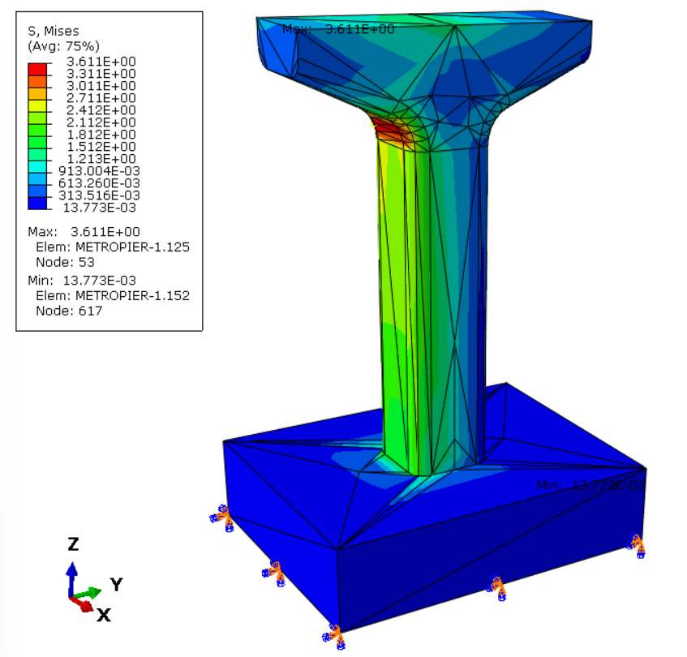 | 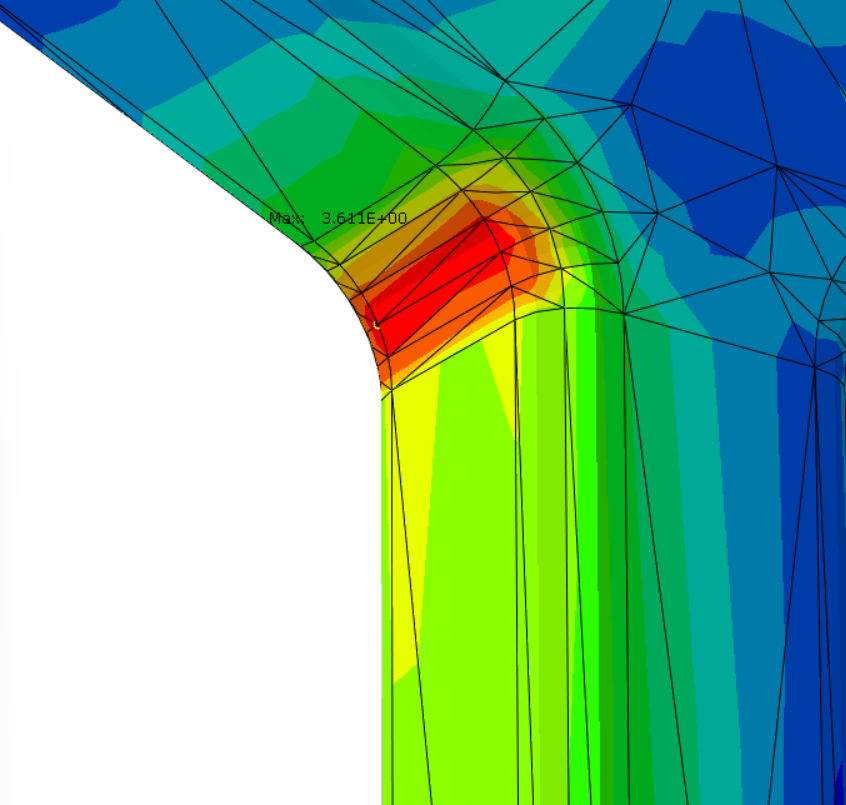 |
| **Case 3: Two Trains (Overall View)** | **Case 3: Haunch Root Close-up** |
| 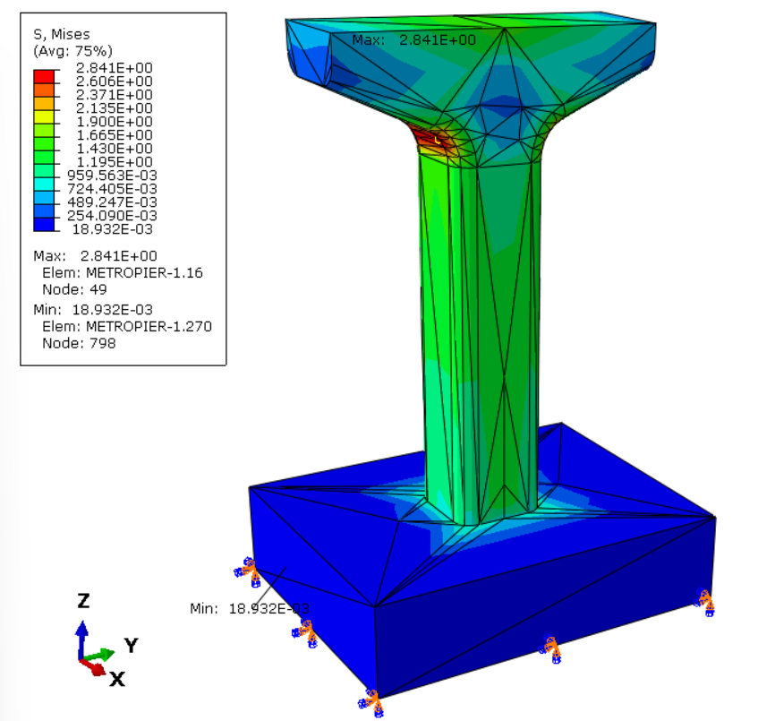 | 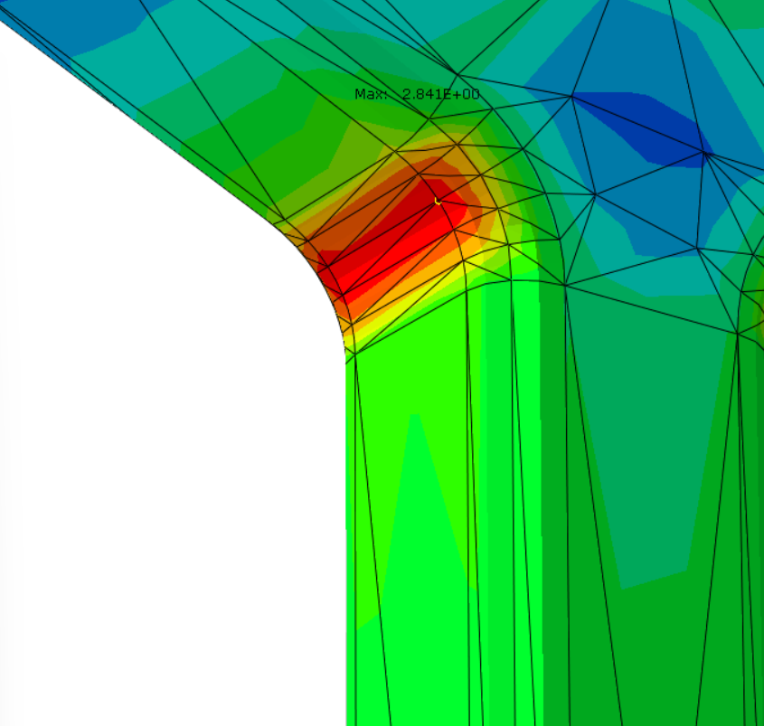 |

* **case 2 peak stress:** localized constitutive von mises stress reaches $\sigma_{\text{vM}} = 3.177\,\text{MPa}$ at element integration points along the haunch re-entrant corner fillet ($R = 2.000\,\text{m}$). Viewport contour legend reports extrapolated peak of $3.611\,\text{MPa}$.
* **case 3 peak stress:** symmetric haunch constitutive stress reaches $\sigma_{\text{vM}} = 2.590\,\text{MPa}$ (contour legend reports $2.841\,\text{MPa}$).

### 3. principal stress fields ($\sigma_1$ tension & $\sigma_3$ compression)

| Maximum Principal Stress ($\sigma_1$, Tension) | Minimum Principal Stress ($\sigma_3$, Compression) |
| :---: | :---: |
| 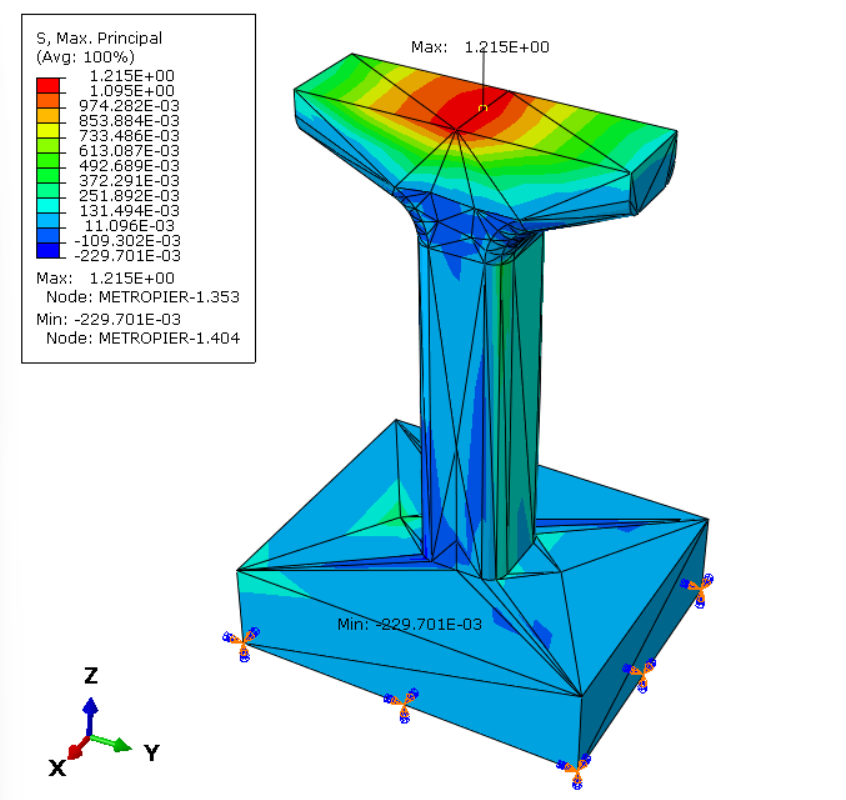 | 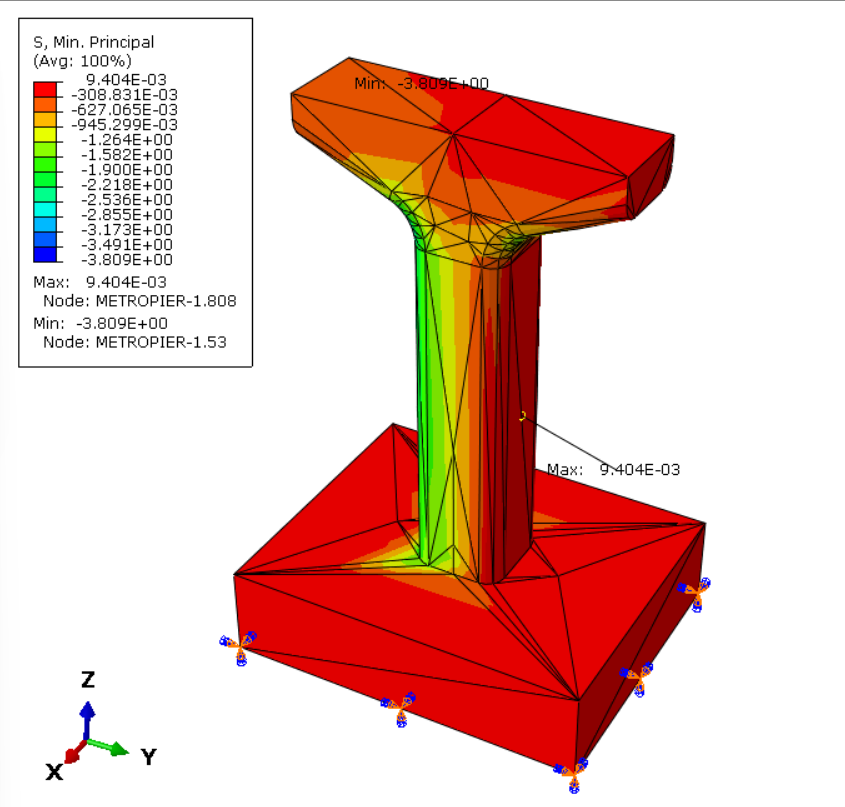 |

* **$\sigma_1$ (tensile cracking check):** peak tensile principal stress $S_{1,\text{max}} = 1.242\,\text{MPa}$ develops along the crosshead upper fibers under Case 3 (2 Trains), providing a safety factor $\text{SF}_{\text{crack}} = \frac{f_r}{S_{1,\text{max}}} = \frac{3.984\,\text{MPa}}{1.242\,\text{MPa}} = 3.21 > 1.0$ against the concrete rupture threshold.
* **$\sigma_3$ (compressive crushing check):** peak compressive principal stress $|S_{3,\text{min}}| = 3.391\,\text{MPa}$ concentrates at the haunch re-entrant corner under Case 2 (1 Train), yielding a crushing safety factor $\text{SF}_{\text{crush}} = \frac{0.60 f'_c}{|S_{3,\text{min}}|} = \frac{24.00\,\text{MPa}}{3.391\,\text{MPa}} = 7.08 \gg 1.0$.

### 4. constitutive gauss integration point stress vs. viewport contour extrapolation
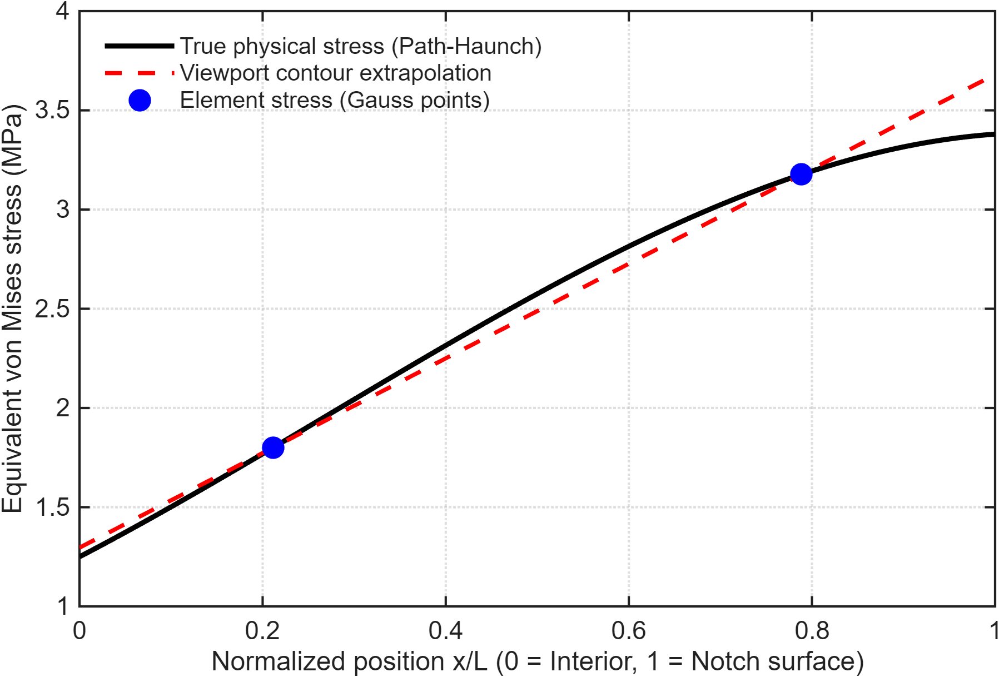

* **constitutive integration point values:** internal stresses evaluated at element gauss integration points reflect true continuum equilibrium without artificial numerical inflation.
* **viewport contour averaging:** abaqus/cae extrapolates integration point values outward to exterior nodes using polynomial shape functions and averages across neighboring elements, naturally overshooting in steep stress concentration gradients.

### 5. stress distribution along haunch path
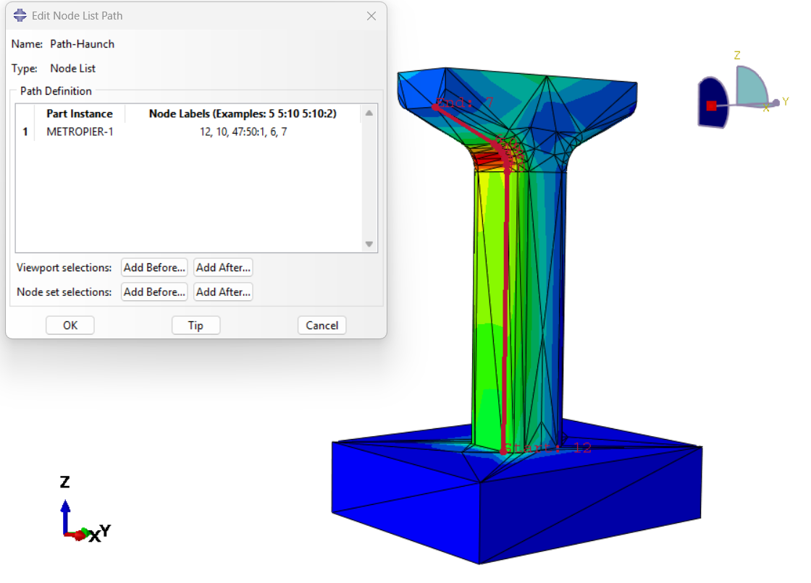
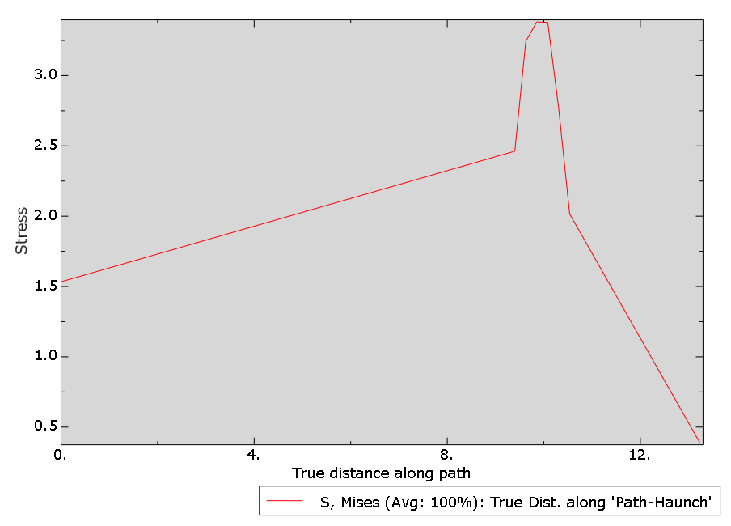

---

## usage & reproduction

### option a: run solver directly via abaqus cli
```bash
abaqus job=Job-Local-35 input=simulation/Job-Local-35.inp interactive
```

### option b: open complete model in abaqus/cae
1. launch abaqus/cae.
2. `File` $\rightarrow$ `Open Database` $\rightarrow$ select `simulation/hcm_metro_pier_analysis.cae`.
3. under the **Job** module, submit `Job-Local-35` or any of the parametric jobs (`Job-Local-40`, `Job-Local-45`, `Job-Local-50`, `Job-Local-55`).

### option c: inspect precomputed output database
```bash
abaqus viewer odb=data/Job-Local-35.odb
```

### option d: reproduce mesh convergence plot
```bash
python scripts/generate_mesh_convergence_plot.py
```

### option e: generate gauss vs nodal extrapolation visual
```matlab
run('scripts/plot_gauss_vs_nodal_extrapolation.m')
```

---

## references

* **metro line 1 dossier:** management authority for urban railways (maur), *design documentation for ho chi minh city urban railway construction project: substructure and superstructure specifications (cầu giản đơn dầm chữ u btdul)*, hcmc, 2020.
* **bridge design code:** ministry of science and technology, *tcvn 11823:2017: highway bridge design specifications (tiêu chuẩn thiết kế cầu đường bộ)*, ministry of transport, hanoi, 2017.
* **fea methodology:** chandrupatla & belegundu, *introduction to finite elements in engineering*, 4th ed., pearson, 2012.
* **abaqus theory:** dassault syst\`emes, *abaqus/cae user's guide* and *abaqus theory guide*, ver. 2024.
